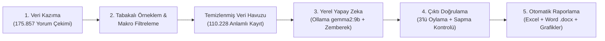
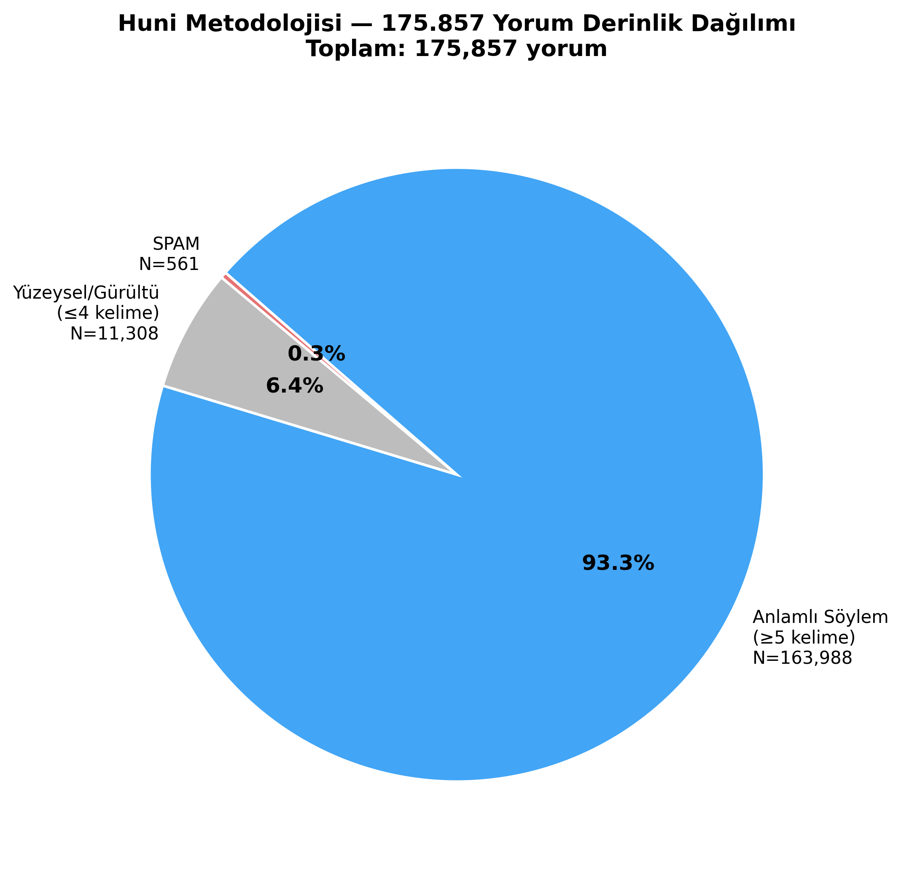
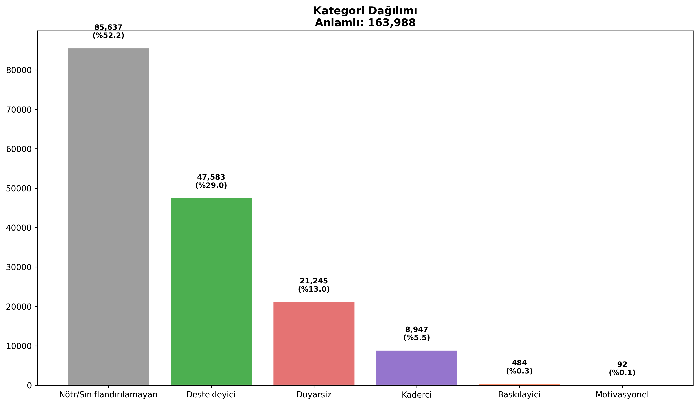
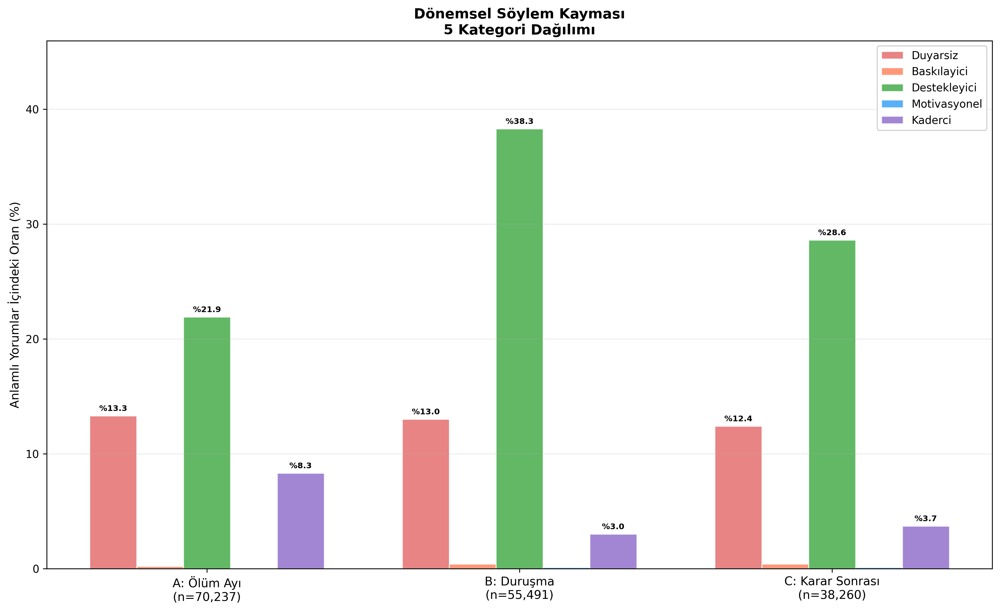
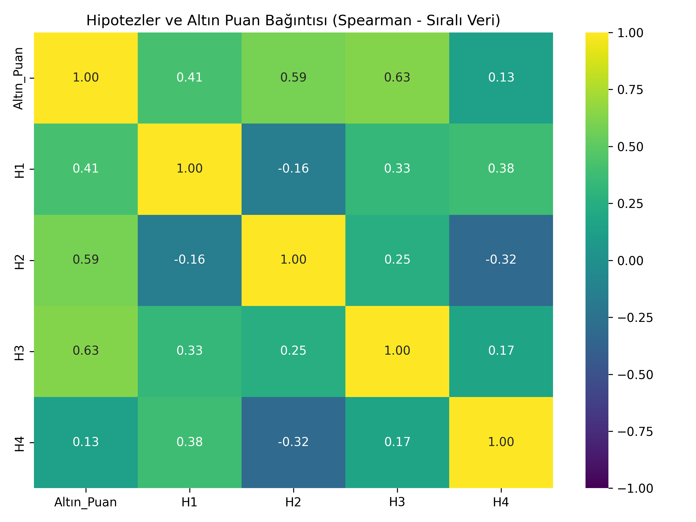
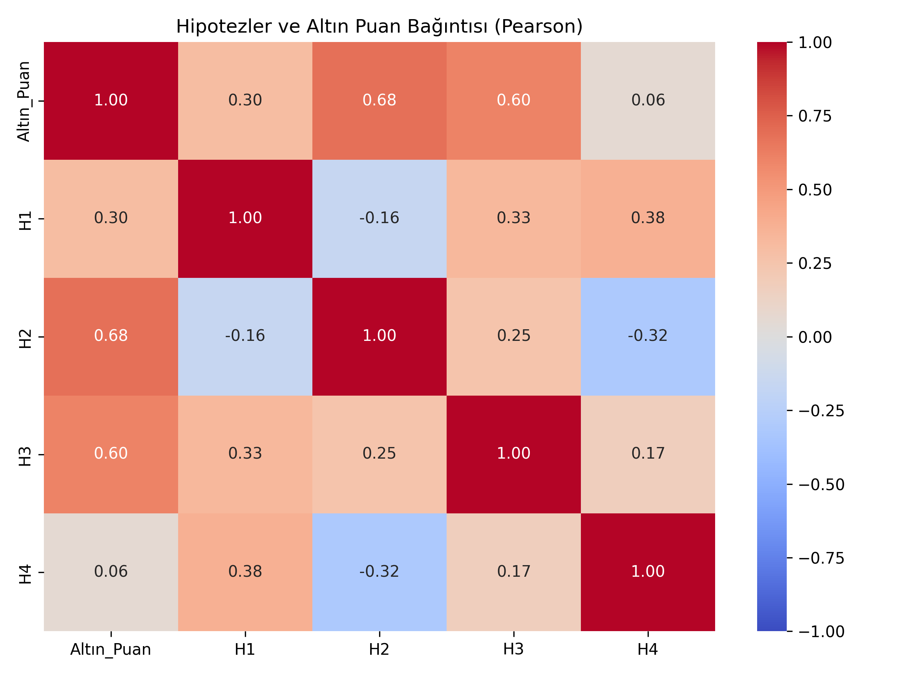
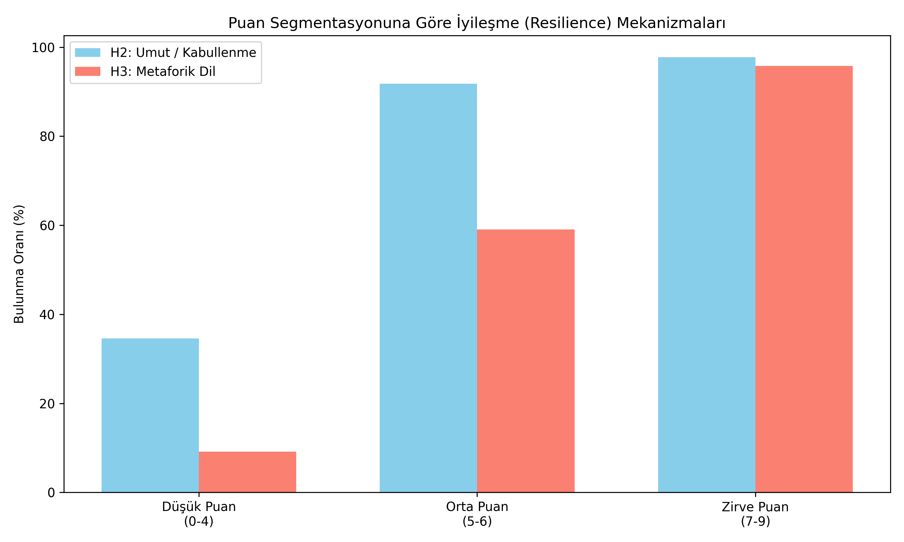

# Veri Kazıma (Web Scraping), Yerel Yapay Zeka Doğrulama ve Otomatik Raporlama Sistemi

Python tabanlı **veri kazıma (Web Scraping)** yöntemiyle toplanan **175.857 satırlık** ham metin verisini Linux ortamında temizleyen, Türkçe morfolojik/kural tabanlı filtrelerden geçiren, yerel dil modelleri (**Ollama / Gemma2:9b**) ile sınıflandıran ve **yapay zekanın ürettiği çıktıları istatistiksel ve kural tabanlı testlerle doğrulayarak** otomatik Excel (`.xlsx`), grafik (`.png`) ve Word (`.docx`) tez raporlarına dönüştüren uçtan uca veri işleme ve otomasyon projesi.

---

## 1. Sistem Mimarisi ve Çalışma Akışı

Büyük hacimli ham verilerin doğrudan dil modeline gönderilmesi hem yüksek donanım maliyeti hem de hatalı sınıflandırma (model sapması) riski oluşturur. Bu projede **Veri Kazıma + Makro Doğal Dil İşleme Süzgeci + Yerel Yapay Zeka Sınıflandırması + Çıktı Doğrulama + Otomatik Rapor Üretimi** adımlarından oluşan beş aşamalı bir yapı kurulmuştur:



### Kaynak Kod Modülleri (`src/`)

| Modül | Dosya | Görev ve İşlevi |
| :--- | :--- | :--- |
| **Tabakalı Örneklem Çekici** | [`src/stratified_sampler.py`](src/stratified_sampler.py) | Veri kazıma ile çekilen 175.857 satırlık ham CSV verisinden Türkçe eylem/kip ekleri ve anahtar kelime kurallarıyla anlamlı kayıtları süzer; her dönemden sabit tohumlama (`random_state=42`) ile 350'şer kayıt seçerek 1.050 satırlık çekirdek veri setini oluşturur. |
| **Makro Veri Analiz Motoru** | [`src/macro_nlp_pipeline.py`](src/macro_nlp_pipeline.py) | 175.857 satırlık veriyi dönemsel kırılımlarla tarar; gürültü ve spam temizliği yapar, dilbilimsel kurallarla 6 ana kategoriye ayırır ve `openpyxl` ile otomatik biçimlendirilmiş Excel raporu üretir. |
| **Yerel Dil Modeli Değerlendirici** | [`src/llm_micro_evaluator.py`](src/llm_micro_evaluator.py) | Zemberek ve düzenli ifadeler (Regex) ile Türkçe ek/kök analizi yapar; Pydantic şema kontrolüyle yerel dil modeli (`gemma2:9b`) sorgularını kesintiye dayanıklı kayıt (JSON Checkpoint) yapısıyla yürütür. |
| **Yapay Zeka Çıktı Denetimi ve Onarımı** | [`src/schema_audit_fix.py`](src/schema_audit_fix.py) | Dil modelinin aşırı genelleme yaparak yanlış etiketlediği kayıtları tespit eder, kural tabanlı çapraz doğrulamadan geçirerek hatalı sınıflandırmaları otomatik olarak düzeltir. |
| **İstatistiksel Doğrulayıcı** | [`src/stats_validator.py`](src/stats_validator.py) | Modelin ürettiği alt boyut skorları ile nihai puanlar arasındaki tutarlılığı **Pearson** ve **Spearman** korelasyon matrisleriyle test eder ve doğrulama grafiklerini üretir. |
| **Otomatik Word Tez Üretici** | [`src/docx_report_generator.py`](src/docx_report_generator.py) | Doğrulanmış Excel/CSV verilerini, istatistiksel tabloları ve üretilen grafikleri `python-docx` kütüphanesiyle birleştirerek doğrudan teslimata hazır Word ([`docs/Nihai_Tez_Raporu.docx`](docs/Nihai_Tez_Raporu.docx)) raporunu oluşturur. |

---

## 2. Yapay Zeka Kod ve Çıktı Doğrulama Süreci

Bu çalışmada yapay zeka modelleri doğrudan güvenilen bir "kara kutu" olarak bırakılmamış; üretilen her çıktı ve sınıflandırma adımı kontrol mekanizmalarından geçirilmiştir:

1. **Veri Şeması Zorlaması (Pydantic):** Dil modelinden dönen JSON yanıtları `Hipotez1..4` ve `SentezSonucu` veri şemalarıyla tip ve puan aralığı kontrolüne tabi tutulmuştur.
2. **Üçlü Çoğunluk Oylaması:** Yüksek puanlı (`puan >= 7`) kritik değerlendirmelerde modelin tek seferlik yanılgılarını engellemek için otomatik 3 tekrarlı oylama uygulanmıştır.
3. **Puan Sapması Kontrolü:** Her 100 kayıtta bir hareketli ortalama izlenerek modelin puanlama standardında kayma olup olmadığı kayıt altına alınmıştır.
4. **Hatalı Etiket Tespiti ve Otomatik Düzeltme:** İlk model koşumunda "Sistem Eleştirisi" içeren metinlerin model tarafından aşırı genellenerek `DUYARSIZ` kategorisine atıldığı (1.050 kaydın 749'u) tespit edilmiş; [`src/schema_audit_fix.py`](src/schema_audit_fix.py) modülü ve güncellenen dilbilimsel kurallarla bu kayıtlar yeniden taranarak veri seti onarılmıştır.

---

## 3. Otomatik Üretilen Analiz ve Doğrulama Grafikleri

### A. Makro Veri Hunisi ve Kategori Dağılımı (175.857 Yorum)



### B. Dönemsel Söylem Değişimi


### C. Model Skor Tutarlılığı: Spearman ve Pearson Korelasyon Matrisleri (1.050 Örneklem)
Modelin alt kriter değerlendirmeleri (H1-H4) ile sentez puanı arasındaki iç tutarlılık Spearman ($r = 0.630$) ve Pearson ($r = 0.681$) korelasyon testleriyle doğrulanmıştır:

| Spearman Korelasyon Matrisi | Pearson Korelasyon Matrisi |
| :---: | :---: |
|  |  |



---

## 4. Kurulum ve Çalıştırma (Linux / Python)

```bash
# 1. Sanal ortam kurulumu ve bağımlılıkların yüklenmesi
python3 -m venv .venv
source .venv/bin/activate
pip install -r requirements.txt

# 2. Yerel dil modeli servisinin hazırlanması (Ollama)
ollama pull gemma2:9b

# 3. Tabakalı örneklem çekimi ve makro veri analizi
python3 src/stratified_sampler.py
python3 src/macro_nlp_pipeline.py

# 4. Yerel dil modeli ile mikro değerlendirme
python3 src/llm_micro_evaluator.py

# 5. Çıktı denetimi, istatistiksel doğrulama ve Word tez raporu üretimi
python3 src/schema_audit_fix.py
python3 src/stats_validator.py
python3 src/docx_report_generator.py
```

---

## 5. Üretilen Nihai Tez Dokümanları ve Excel Raporları

### 📄 Akademik Tez ve Metodoloji Dokümanları (`docs/`)
* [`docs/Nihai_Tez_Raporu.docx`](docs/Nihai_Tez_Raporu.docx) — 175.857 veri üzerinden yürütülen dilsel/söylemsel analizin kuramsal çerçevesini, metodolojisini, istatistiksel tablolarını ve bulgularını içeren nihai tez çalışması.
* [`docs/Metodoloji_Bulgular_100_Orneklem_Analizi.docx`](docs/Metodoloji_Bulgular_100_Orneklem_Analizi.docx) — Metodoloji, bulgular ve 100 seçilmiş örneklemin detaylı dilsel çözümleme tablosu.
* [`docs/Tez_Kodlama_Rehberi.pdf`](docs/Tez_Kodlama_Rehberi.pdf) — Yerel dil modeli sistem mesajlarına ve filtreleme kurallarına temel oluşturan kategorik kodlama rehberi.
* [`docs/Ornek_Veri_Cozumleme_Tablosu.docx`](docs/Ornek_Veri_Cozumleme_Tablosu.docx) — Dilbilimsel unsurlar (kip, zaman, metafor) ile H1-H4 hipotezlerinin eşleştirildiği referans tablo.

### 📊 Otomatik Üretilen Excel Veri Raporları (`sample_outputs/`)
* [`sample_outputs/Makro_NLP_Raporu_175K_Final.xlsx`](sample_outputs/Makro_NLP_Raporu_175K_Final.xlsx) — 175.857 yorumun dönem, kategori ve filtre kırılımlarını içeren çok sayfalı, otomatik biçimlendirilmiş ana rapor.
* [`sample_outputs/Tez_ANALIZ_1050_DETAYLI.xlsx`](sample_outputs/Tez_ANALIZ_1050_DETAYLI.xlsx) — Morfolojik analiz, güven skoru, çoğunluk oylaması ve alt hipotez kırılımlarını içeren 1.050 satırlık doğrulanmış veri tablosu.
* [`sample_outputs/Tez_ALTIN_ORNEKLER_50_BEST.xlsx`](sample_outputs/Tez_ALTIN_ORNEKLER_50_BEST.xlsx) — En yüksek tutarlılık skoruna sahip 50 referans kayıt.
